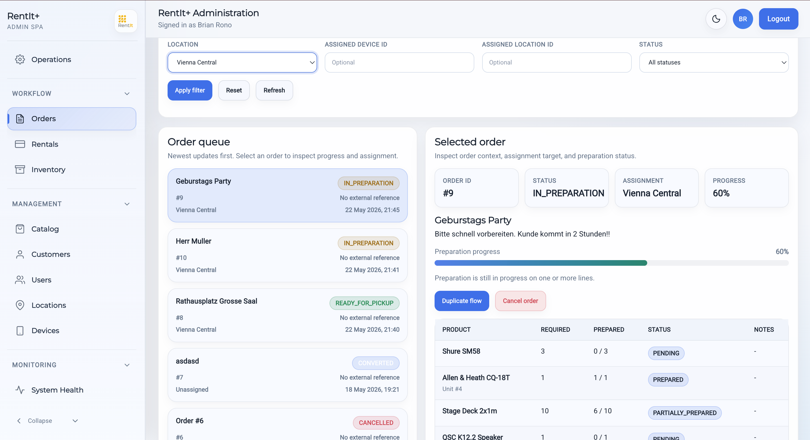
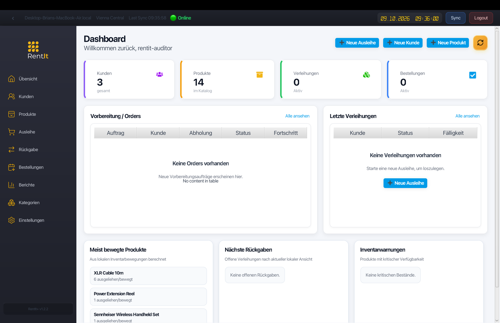

# RentIt+ | Rental and inventory management

RentIt+ is a completed HTL diploma project: a rental and inventory management system with a JavaFX desktop client, a web administration interface, and a Spring Boot backend. The desktop client stores operational data in SQLite and synchronizes local changes with a central PostgreSQL database.

I created this companion repository to present RentIt+ through its architecture, workflows, desktop releases, and engineering decisions. The project was developed as an HTL diploma project by Brian Rono and Babak Nourbakhsh. The application source remains private; this repository provides a public view of how the system works.

**[Download Desktop v1.2.3](https://github.com/brianronock/rentitplus/releases/tag/v1.2.3)** · **[Web SPA](https://rentitspa.brianronock.com)** · **[Portfolio](https://brianronock.com)**



*The web order queue shows preparation progress and order details for the selected location.*

## Download the desktop client

| Platform | Installer |
|---|---|
| macOS | [RentIt+.Desktop-1.2.3.dmg](https://github.com/brianronock/rentitplus/releases/download/v1.2.3/RentIt%2B.Desktop-1.2.3.dmg) |
| Windows | [RentIt+.Desktop-1.2.3.exe](https://github.com/brianronock/rentitplus/releases/download/v1.2.3/RentIt%2B.Desktop-1.2.3.exe) |
| Linux, amd64 | [rentitplus-desktop_1.2.3_amd64.deb](https://github.com/brianronock/rentitplus/releases/download/v1.2.3/rentitplus-desktop_1.2.3_amd64.deb) |

Version 1.2.3 updates the production API address and migrates existing desktop configurations that use the retired production endpoint. See the [installation and upgrade guide](docs/desktop-release.md) for setup, checksums, and the macOS notarization limitation.

GitHub's automatic **Source code** archives contain this companion repository only, not the application source or installers.

## The problem

Rental operations involve several related decisions: what stock is available at a location, which physical unit is being issued, what a customer has rented, and what has been returned. A desktop used at a service desk or equipment store should retain local working data during a network interruption.

RentIt+ separates local work from server confirmation. A desktop operation can be stored locally, but shared availability and concurrent changes still require server validation. Offline-first operation therefore introduces reconciliation and conflict handling; it does not guarantee that every local change will be accepted later.

## What the project implements

| Area | Implemented responsibility |
|---|---|
| Catalog | Products, categories, pooled stock, and individually tracked units |
| Inventory | Location-specific balances, physical units, and inventory transactions |
| Customers | Customer records and management workflows |
| Orders | Preparation, order lines, assignment, and cancellation workflows |
| Rentals | Checkout, rental lines, and return workflows |
| Desktop | JavaFX interface, SQLite persistence, local changes, and HTTP synchronization |
| Web administration | Vue interface for catalog, customers, inventory, orders, rentals, devices, and operational views |
| Observability | HTTP and synchronization events, persisted history, and live SSE streams |
| Load Lab | Python scenario runner with a separate control API and interface |
| MCP | Private runtime with read-only operational tools callable from the administrator SPA and compatible MCP clients |

Load Lab and MCP support testing and operational analysis. Finance, maintenance planning, and advanced scheduling are outside the completed project scope.

## System overview


The observability box represents backend event handling and streaming. The separate MCP runtime extends access to operational data through read-only tools.

The backend is organized as a modular monolith with domain, application, and adapter modules. The desktop has its own local models and persistence layer, while shared libraries define common domain types and synchronization messages.



*The JavaFX client keeps a local working store and synchronizes with the backend.*

## Explore the project

1. [Guided project tour](docs/project-tour.md): the operational story and suggested review paths.
2. [Architecture and module boundaries](docs/architecture.md): runtime responsibilities and design tradeoffs.
3. [Domain model and workflows](docs/domain-and-workflows.md): inventory, preparation, checkout, and returns.
4. [Offline synchronization](docs/synchronization.md): local identity, acknowledgements, canonical data, and conflicts.
5. [Observability and MCP](docs/observability-and-mcp.md): visual operational views and read-only tools.
6. [Testing and Load Lab](docs/testing-and-load-lab.md): test layers, workflow scenarios, and concurrency checks.
7. [Desktop installation and upgrades](docs/desktop-release.md): setup, checksums, and migration behavior.
8. [Illustrative protocol samples](samples/README.md): small synthetic JSON examples.

The technical articles describe the implementation associated with desktop release v1.2.3, including its design tradeoffs and operational limits.

## Technology stack

| Area | Technologies |
|---|---|
| Backend | Java 21, Spring Boot, Spring Web, Spring Security, JPA/Hibernate |
| Server persistence | PostgreSQL, Flyway |
| Desktop | JavaFX, SQLite, Java HTTP client |
| Web | Vue 3, Vite, Pinia, Vue Router |
| Testing and lab | JUnit, Mockito, AssertJ, Testcontainers, Python scenarios, FastAPI |
| Delivery | Gradle, Docker Compose, GitHub Actions, jpackage |
| Hosting | AWS EC2, Caddy, Cloudflare; Cloudflare Pages for the SPA |

## Reviewing the demo

The [web SPA](https://rentitspa.brianronock.com) and desktop client use the API at `https://rentitapi.brianronock.com`. Account access is separate from downloading an installer.

Treat the shared demo as a demonstration environment. The auditor role supports selected order and desktop rental workflows, so it is not a strictly read-only account. Use only fictional data and avoid changing other visitors' records. For an initial review, start with the documentation and browse existing data.

## Repository contents

```text
README.md
docs/          Architecture, workflows, sync, operational tools, and installation
samples/       Synthetic synchronization payloads with explanations
screenshots/   Desktop, web, synchronization, Load Lab, and MCP views
diagrams/      System, workflow, persistence, and module illustrations
```

Installers are available through [GitHub Releases](https://github.com/brianronock/rentitplus/releases). The protocol samples use fictional data to explain the message formats. Application source and deployment configuration remain in the private repository.

## Authors and publication

**Brian Rono** and **Babak Nourbakhsh**

HTL diploma project in software engineering.

This repository is provided for portfolio review and educational reference. The contents are **all rights reserved**; no open-source license has been granted. Third-party software bundled with desktop installers is subject to its respective license terms.
