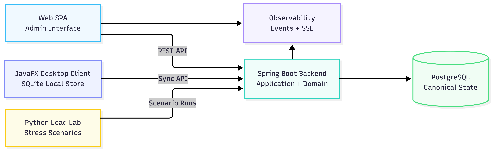

# Architecture and module boundaries

[Back to the project overview](../README.md)

## Runtime structure

RentIt+ combines a central backend with two different clients. The Vue SPA uses the backend's HTTP API for administration. The JavaFX desktop client keeps a SQLite database and exchanges synchronization messages with the backend. PostgreSQL holds canonical server state.

The main backend is a modular monolith. Its modules separate responsibilities within one application; they are not individual microservices. The Load Lab and MCP runtime are separate supporting tools.

## Module responsibilities

| Module | Responsibility |
|---|---|
| `rentit-shared-domain` | Domain types used across server and desktop, including identity, catalog, inventory, orders, rentals, and authentication models |
| `rentit-shared-sync` | Synchronization request/response types, mutations, acknowledgements, and conflicts |
| `rentit-core-domain` | Server-side domain contracts, inbound use-case ports, outbound ports, and domain exceptions |
| `rentit-application` | Use-case implementations, workflow coordination, and server synchronization services |
| `rentit-adapter-web` | HTTP controllers, payload mapping, authentication integration, and request context |
| `rentit-adapter-persistence-jpa` | JPA entities, repositories, and adapters implementing persistence ports |
| `rentit-boot` | Backend composition, application configuration, and database migrations |
| `rentit-desktop-core` | Local models, SQLite repositories, desktop services, HTTP clients, and sync managers |
| `rentit-desktop-ui` | JavaFX views, controllers, setup, and user interaction |
| `rentit-web-spa` | Vue administration interface and HTTP client integration |
| `rentit-observability` | Event types, publishing/reading contracts, and adapters for operational history and streaming |
| `rentit-load-lab` | Scenario execution and a separate FastAPI control surface |
| `rentit-mcp-server` | Separate Spring runtime exposing operational event queries through MCP tools |

The modules share a Gradle build. The application source is maintained separately from this public companion repository.

## Ports and adapters in practice

A web controller maps an HTTP request into an application command and invokes a use case. Application services coordinate the domain operation through ports; persistence adapters translate between domain objects and database entities. The boot module assembles these components.

For example, order creation crosses an HTTP payload mapper, an order-creation use case, and persistence ports. Desktop order synchronization reaches the backend through a different controller and a sync service, which interprets submitted mutations in terms of business operations.

The separation gives the implementation places to distinguish transport validation, business decisions, and storage mechanics. It does not mean that every layer is framework-free: application services use Spring dependency injection and transaction support.

## Local and canonical models

The desktop database is a local working store, not a direct connection to PostgreSQL. Local records carry information needed for disconnected work, including client references and pending synchronization state. The server assigns its own identifiers and versions.

Shared protocol types bridge these representations. They let the two runtimes exchange explicit messages without making the desktop depend on JPA entities or the server depend on desktop repositories. The cost is additional mapping and careful handling of identifiers, relationships, and rejected changes.

## Business structure

Products describe catalog entries. Inventory distinguishes quantities and individually tracked units at locations. Orders represent preparation work, while rentals represent issued items and their return lifecycle. Inventory transactions and balance views support reconciliation of stock changes.

Location context and authorization serve different purposes: the first identifies the operational scope, while the second determines which actions a caller may perform.

## Observability and supporting tools

Backend observability records HTTP activity and synchronization outcomes, with persisted history and SSE streams for operational views. It helps connect a user-visible conflict to the operation and server decision that produced it.

Load Lab exercises backend and synchronization behavior through repeatable workflows, concurrent workers, and inventory checks.

The MCP runtime provides read-only tools for recent events, events requiring attention, synchronization health, and conflict explanations. It reuses the operational-event read abstraction to provide context to compatible clients.

## Design tradeoffs

- **Local continuity versus immediate consistency:** a desktop can retain changes while disconnected, but acceptance is deferred until synchronization.
- **A single backend versus independent service deployment:** module boundaries keep responsibilities explicit without requiring a distributed backend deployment.
- **Shared contracts versus independent evolution:** common message types reduce duplication, but clients and server still need compatible protocol behavior.
- **Operational visibility versus data minimization:** detailed events help explain failures, while public demonstrations require care over which data and metadata are exposed.

See [offline synchronization](synchronization.md) for the exchange between local and canonical state.
