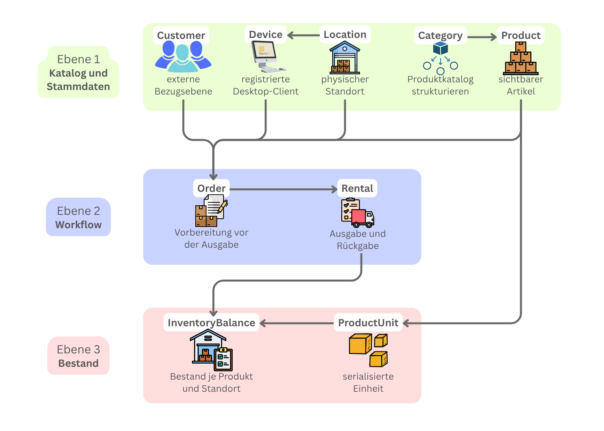
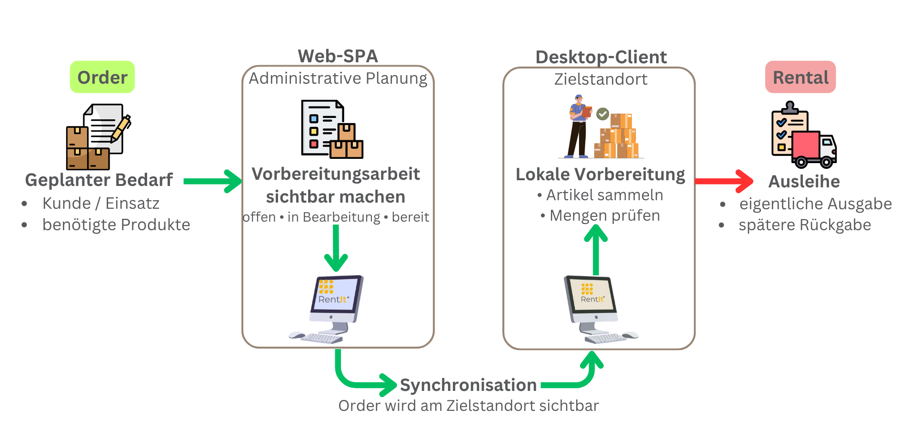
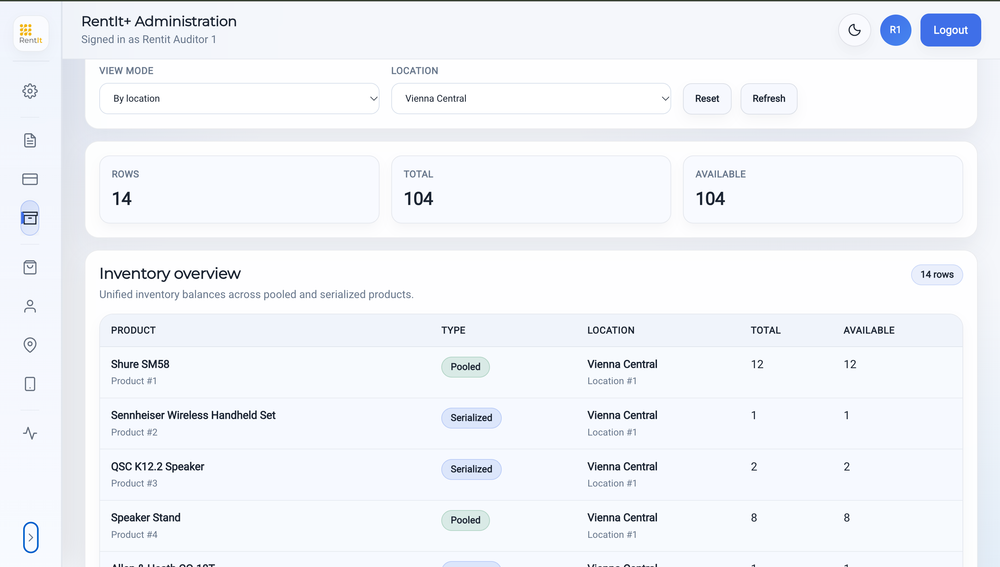

# Domain model and workflows

[Back to the project overview](../README.md)

## Core concepts

| Concept | Meaning and relationship |
|---|---|
| Product | A catalog item; it can be represented through pooled quantities or individually tracked units |
| Category | Classification of products |
| Product unit | One physical item, with serial information, condition, status, and location |
| Location | Physical context for stock and operational workflows |
| Inventory balance | Total and available quantities for a product/location context |
| Inventory transaction | A recorded inventory change supporting stock reconciliation |
| Customer | The customer associated with orders and rentals |
| Order and order line | Preparation work and the products/quantities to be fulfilled |
| Rental and rental line | Issued items and their return-related state |
| Device | A registered desktop identity associated with a location |

This table is a conceptual model, not a complete database schema. Server persistence uses JPA entities and PostgreSQL migrations; desktop persistence uses local models and SQLite repositories.

*Original thesis figure, with German labels: catalog and contextual data support orders and rentals, which connect to physical units and inventory balances. This is a conceptual overview, not an entity-relationship schema.*

## Why orders and rentals are separate

An order represents work before handover. Its lines describe what is requested and prepared. A rental represents the issued items and their subsequent return lifecycle. Keeping these concepts separate avoids treating every preparation step as an already completed checkout.

The order status model includes `DRAFT`, `OPEN`, `IN_PREPARATION`, `READY_FOR_PICKUP`, `CONVERTED`, and `CANCELLED`. `DRAFT` is a local preparation state. A typical preparation path moves toward readiness and then conversion, subject to business validation.

The rental status model includes `ACTIVE`, `RETURNED`, `LOST`, `CANCELLED`, and `DRAFT`. Checkout and return are the principal workflows described here.

*Original thesis figure: web planning and desktop preparation lead from an order to a rental, separating requested items from actual issue and return.*

## A concrete workflow

The desktop-conversion scenario in Load Lab exercises the following sequence:

1. Create an order through the REST API.
2. Submit preparation changes through synchronization.
3. Create the rental through synchronization.
4. Synchronize the order's conversion state.
5. Return the rental through synchronization.

The workflow crosses several requests, making intermediate states, validation, and repeat handling important implementation concerns.

## Partial returns

A quantity-based rental can be returned in stages. The partial-return scenario starts with a quantity of two, returns one, then returns the remaining quantity. Its intended inventory sequence is initial availability, initial minus two, initial minus one, then restored availability.

The scenario checks both intermediate inventory effects and final rental state, so its assertions go beyond the HTTP response status.

## Pooled stock and individually tracked units

For pooled stock, quantity is the relevant operational measure. For an individually tracked unit, the identity and condition of the physical item also matter. Product-unit models therefore retain serial information, location, condition, and status.

The balance model enforces basic bounds such as non-negative availability and availability not exceeding total quantity. Concurrent checkout still needs server-side coordination; a valid local balance alone cannot prevent two disconnected clients from selecting the same remaining stock.

*Location inventory connects available quantities with the products and units held there.*

## Persistence and synchronization

Local and server IDs have different roles. Stable client references connect offline-created records to server acknowledgements, while versions support stale-update detection. Local pending state is synchronization bookkeeping and should not be confused with a business status such as `READY_FOR_PICKUP`.

See [offline synchronization](synchronization.md) for this distinction in an order exchange.
