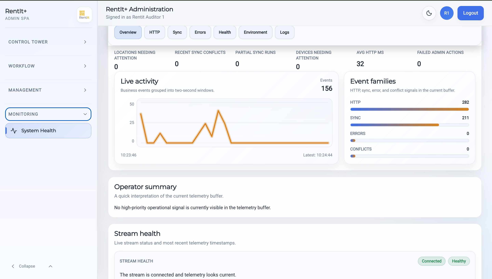
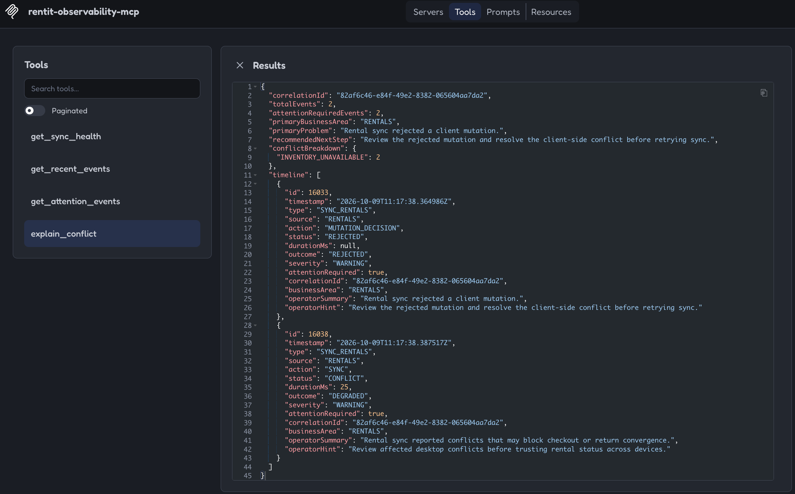

# Observability and MCP

[Back to the project overview](../README.md)

## Explaining operational behavior

A synchronization failure can originate in a request, a business decision, or reconciliation of client state. RentIt+ includes HTTP and domain/synchronization events so these outcomes can be inspected rather than inferred from a generic error message.

The observability implementation separates event models, publishing and reading contracts, and adapters. It provides recent events, persisted history, and SSE streams. The SPA contains operational views for health, HTTP activity, synchronization, errors, and event details.

## Correlation and summaries

Correlation identifiers connect related events. The service builds summaries describing an outcome, severity, whether attention is required, the business area, and an operator-oriented explanation. An operator can select a problematic operation and follow its recorded context.

*Event details connect a recorded outcome to its operational context.*

## The separate MCP runtime

The MCP server reuses the operational-event read abstraction and persistence adapter. Its tool implementations query existing event data and return shaped summaries.

| Tool | Purpose |
|---|---|
| `get_recent_events` | Recent operational events, with optional event type, location, device, actor, and limit filters |
| `get_attention_events` | Events identified as requiring attention |
| `get_sync_health` | Counts and recent problematic events for synchronization activity |
| `explain_conflict` | A timeline and explanation for a supplied correlation ID |

Queries default to 50 events and are capped at 200 by the server configuration.

MCP gives compatible assistants access to the same operational context through structured tool calls. The tools retrieve event information and summaries; business mutations remain outside this tool set.

## From tool call to operational context

A synchronization-health query summarizes recorded outcomes. A conflict explanation follows a correlation ID through its event timeline and returns a primary problem and suggested next step. This makes application-specific context available without requiring the assistant to interpret an unrestricted database dump.

*A structured MCP query exposes operational context to a compatible client.*

The tool response comes from recorded application events. Any explanation produced by a consuming assistant is a separate interpretation of that data. Keeping this boundary explicit helps distinguish what the system recorded from what an assistant inferred.
