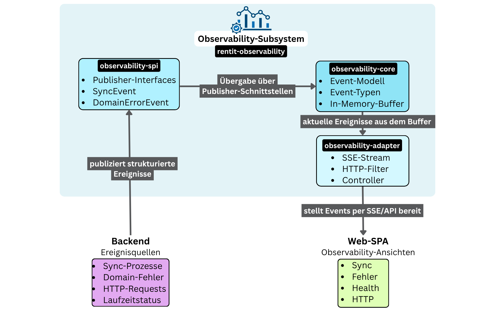
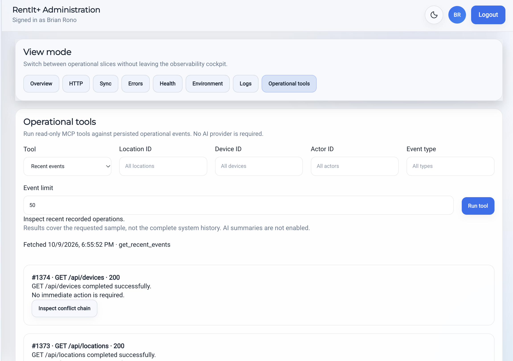

# Observability and MCP

[Back to the project overview](../README.md)

## Explaining operational behavior

A synchronization failure can originate in a request, a business decision, or reconciliation of client state. RentIt+ includes HTTP and domain/synchronization events so these outcomes can be inspected rather than inferred from a generic error message.

The observability implementation separates event models, publishing and reading contracts, and adapters. It provides recent events, persisted history, and SSE streams. The SPA contains operational views for health, HTTP activity, synchronization, errors, and event details.

*Original thesis figure, with German labels: backend event sources publish through interfaces; the observability components provide events to the SPA through SSE and API views. The figure emphasizes the recent-event buffer; persisted history is an additional part of the implementation.*

## Correlation and summaries

Correlation identifiers connect related events. The service builds summaries describing an outcome, severity, whether attention is required, the business area, and an operator-oriented explanation. An operator can select a problematic operation and follow its recorded context.

*The System Health view summarizes event activity, event families, operator information, and stream health.*

## The separate MCP runtime

The MCP server reuses the operational-event read abstraction and persistence adapter. Its tool implementations query existing event data and return shaped summaries.

| Tool | Purpose |
|---|---|
| `get_recent_events` | Recent operational events, with optional event type, location, device, actor, and limit filters |
| `get_attention_events` | Events identified as requiring attention |
| `get_sync_health` | Counts and recent problematic events for synchronization activity |
| `explain_conflict` | A timeline and explanation for a supplied correlation ID |

Queries default to 50 events and are capped at 200 by the server configuration.

MCP gives compatible assistants access to the same operational context through structured tool calls. The tools retrieve event information and summaries; business mutations remain outside this tool set.

## Operational tools in the deployed SPA

Administrators can also execute all four tools directly from the SPA's **System Health → Operational tools** view. The authenticated backend validates the request and calls the separate MCP service over the MCP protocol. Results include event summaries, synchronization health, and correlation-based explanations; no AI provider is required.

The MCP service is deployed alongside the backend through the same deployment workflow. It remains on the private container network, uses service authentication, and connects through a dedicated database account with read access to the operational-event table. The existing SPA observability views continue to use their original API endpoints.

*An administrator executes a read-only MCP tool from the SPA and inspects the recorded operational context.*

Queries cover a bounded sample of recorded events, not the complete system history. Manual tool execution is implemented and deployed. AI-generated administrator summaries remain deferred; provider configuration is prepared, but no AI provider is connected or called.

## From tool call to operational context

A synchronization-health query summarizes recorded outcomes. A conflict explanation follows a correlation ID through its event timeline and returns a primary problem and suggested next step. This makes application-specific context available without requiring the assistant to interpret an unrestricted database dump.

*A structured MCP query exposes operational context to a compatible client.*

The tool response comes from recorded application events. Any explanation produced by a consuming assistant is a separate interpretation of that data. Keeping this boundary explicit helps distinguish what the system recorded from what an assistant inferred.
