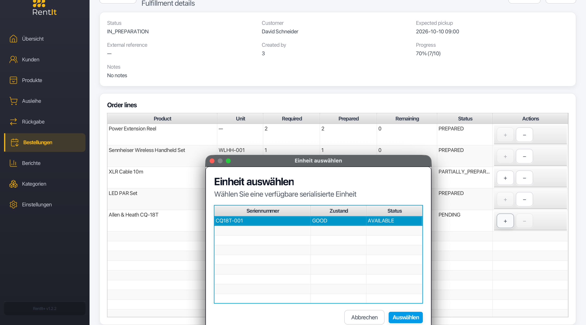
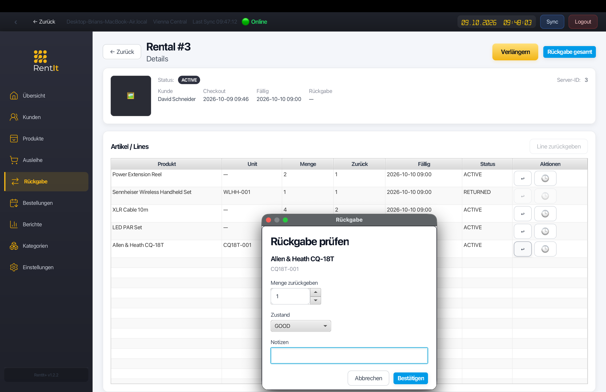
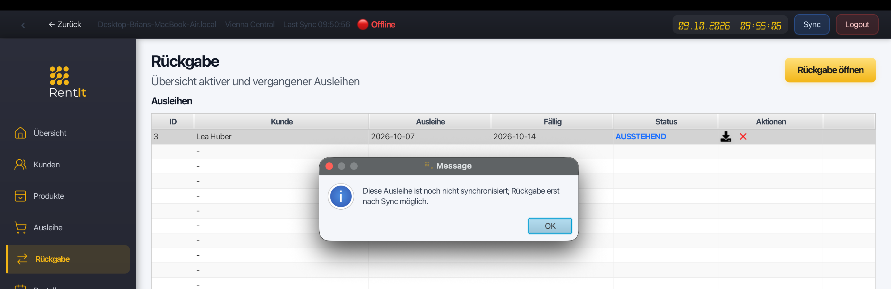
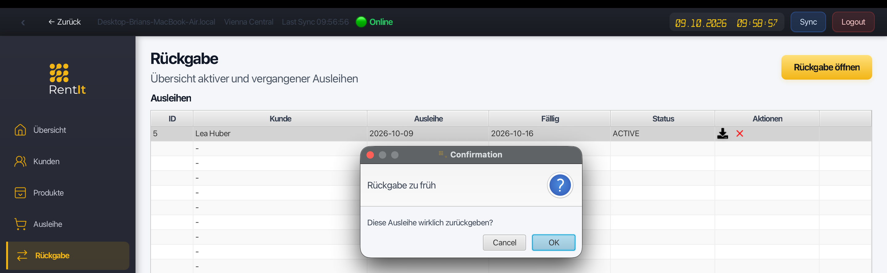

# RentIt+ in practice

[Back to the project overview](../README.md)

RentIt+ connects preparation, checkout, and return across a central web interface and a desktop client with local persistence. This walkthrough follows the main workflow and the supporting tools used to understand its behavior.

Screenshots illustrate workflows from project development. Some desktop captures display v1.2.2; the current downloadable installer is v1.2.3.

## Central operations in the web interface

The web SPA brings catalog, customers, inventory, orders, rentals, and device information together. Location context connects these views to the physical place where equipment is held and issued.

*Orders at Vienna Central, with preparation progress and details for the selected order.*

## A local desktop workspace

The JavaFX client keeps its working data in SQLite. It supports operational work with local state while synchronization coordinates changes with the backend. The desktop and SPA share business concepts, but use different persistence and interaction models.

*The desktop workspace combines local data with synchronization to the central system.*

## From preparation to rental

An order captures the items to prepare before handover. Its lines hold quantities and fulfillment state; conversion moves the workflow into a rental that records the issued items.

*Preparing quantities and selecting an available serialized unit before checkout.*

Returns complete the operational cycle. Line-level return behavior supports bringing back part of a rental before the remaining items, with availability adjusted as items return.

*A rental with partially returned quantities and a return dialog for an individually tracked unit.*

The [domain guide](domain-and-workflows.md) explains the distinction between catalog, inventory, orders, and rentals.

## Local work and synchronization

When connectivity is interrupted, local persistence separates saving a change from obtaining server confirmation. Reconnection allows the client to submit pending mutations and reconcile the response. Changes that conflict with server state require an explicit outcome.

*The offline desktop blocks a return for a rental that has not yet been synchronized.*

*A separate online example shows an early-return confirmation. These two captures show different rentals, rather than a before-and-after synchronization sequence.*

The [synchronization article](synchronization.md) follows this exchange through client references, versions, acknowledgements, and conflicts.

## Understanding system behavior

Operational events link activity in the interface to HTTP requests and synchronization decisions. Load Lab exercises multi-step workflows and concurrency, while MCP tools expose operational summaries to compatible clients.

Continue with [observability and MCP](observability-and-mcp.md) or [testing and Load Lab](testing-and-load-lab.md) for the engineering behind these views.
