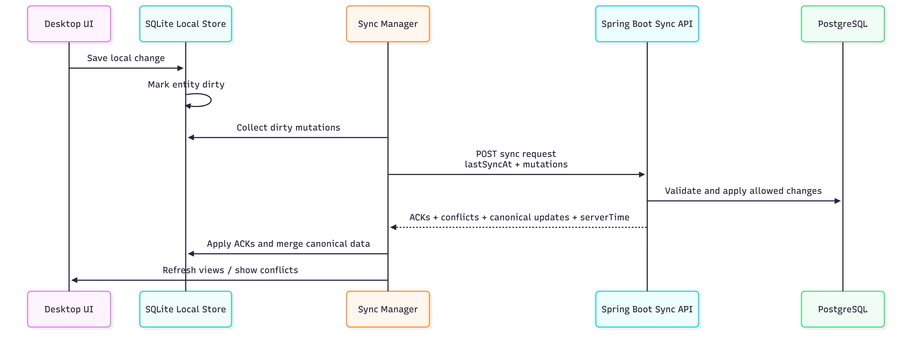
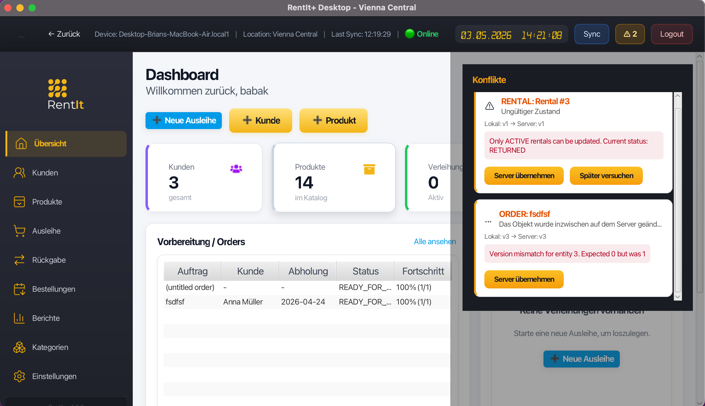

# Offline synchronization

[Back to the project overview](../README.md)

## Why a synchronization protocol is necessary

Two desktop clients can act on different local views of the same inventory. A local save cannot establish global availability or guarantee that another device has not already changed a record. RentIt+ therefore treats local changes as pending work and lets the server determine which changes become canonical.

The sequence summarizes the exchange. Individual aggregates have their own validation and merge rules, and the exchange spans local processing and a server request.

## An order synchronization round

The order sync manager provides a concrete example of the implemented flow:

1. Read the order synchronization cursor and collect eligible dirty orders and order lines from SQLite.
2. Ensure those records have stable client references and construct mutation payloads.
3. Send an `OrderSyncRequest` containing the last synchronization timestamp and the order and line mutations.
4. Let the backend process those mutations using the order workflow and persistence layer.
5. Receive an `OrderSyncResponse` containing `serverTime`, canonical `orders`, `acks`, and `conflicts`.
6. Apply acknowledgements, handle conflicts, and merge returned server data into local records.
7. Advance the order cursor when the response supplies a server time, and notify the desktop conflict interface.

The implementation has separate sync managers and payloads for other areas. An HTTP success response alone does not establish that every submitted mutation was applied; the client must inspect the individual outcomes.

## Identity and versions

A newly created local record may not yet have a server ID. A stable client reference lets the server response be correlated with that local record. An applied acknowledgement can supply the server ID and version, allowing subsequent operations to refer to canonical identity.

Versions support checks against stale changes. This matters when two clients edit from different starting states. A version mismatch or business-rule violation needs an explicit outcome rather than silently assuming that the most recent upload should overwrite the server.

## Acknowledgements and conflicts

The shared acknowledgement model distinguishes `APPLIED`, `CONFLICT`, and `ERROR`. It identifies the entity, client reference, and operation; server identity/version and structured error information are supplied where applicable.

A conflict is a business or synchronization outcome that must be reconciled, not simply a lost network request. Retrying an unchanged request cannot necessarily resolve a stale version or unavailable stock. Client conflict handling and canonical-data merging depend on the aggregate involved.

*A conflict explanation exposes the server decision that requires reconciliation.*

## Business operations rather than arbitrary row replacement

Mutation types include create, update, and delete, but their meaning is interpreted by the server. For example, deleting an order through synchronization is processed through an order-cancellation workflow. Rental updates can represent return or cancellation transitions.

This keeps synchronization aligned with business rules: a cancellation or return is processed as an operation with inventory consequences.

## Local state and its limits

SQLite retains desktop working data and pending changes. Synchronization reconciles that state with the backend when connectivity and authentication permit it. First-run setup, registration, and the initial retrieval of server data require connectivity.

The web SPA uses the online backend API. It does not share the desktop's SQLite persistence model.

## The main tradeoff

Local persistence allows work to continue before the server is reachable. The cost is managing two states: what the client has saved and what the server has accepted. Stable references, explicit outcomes, and version-aware reconciliation make that distinction part of the protocol.

The [sample payloads](../samples/README.md) illustrate an order pull request and an applied acknowledgement with fictional identifiers.
