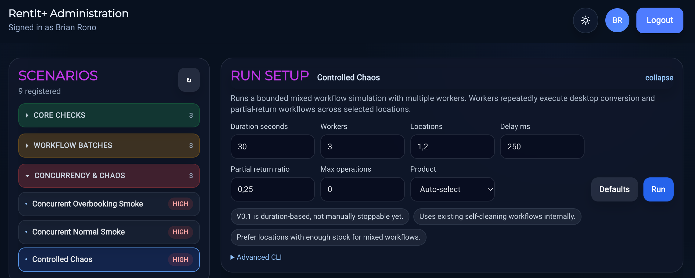
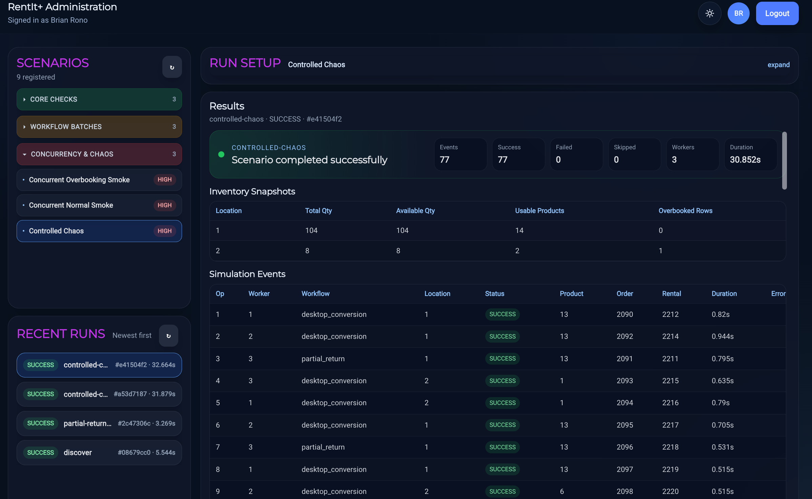

# Testing strategy and Load Lab

[Back to the project overview](../README.md)

## Testing at different boundaries

The test suite separates domain rules, application workflows, database adapters, and desktop synchronization behavior:

| Area | Test examples | What the tests address |
|---|---|---|
| Shared domain | `ProductUnitInvariantTest`, `RentalInvariantTest`, `RentalLineInvariantTest` | Domain-model invariants |
| Sync contracts | `SyncAckTest`, `ProductSyncMutationTest` | Acknowledgement and mutation behavior |
| Application services | `CreateRentalServiceTest`, `ReturnRentalServiceTest`, `RentalSyncServiceTest` | Business and synchronization service behavior |
| Persistence adapters | Product, customer, inventory, and rental adapter tests | Database mapping and persistence behavior; a shared PostgreSQL Testcontainers fixture is present |
| Desktop synchronization | `ProductSyncManagerApplyAcksTest`, `ProductSyncManagerMergeOnlyWhenLocalCleanTest`, `ProductSyncManagerMergeNeverResurrectsDeletedTest` | Acknowledgements and protection of pending/deleted local state |

Domain and service tests isolate individual rules. Persistence tests exercise database behavior, while desktop synchronization tests address the relationship between pending local changes and returned server data.

## Why add a scenario runner?

A unit test can exercise a particular rule. A multi-request scenario investigates the combined behavior of authentication, HTTP endpoints, synchronization, business state, and inventory. Load Lab complements the narrower tests with realistic workflow sequences and concurrent workers.

The implementation includes a Python scenario registry, command-line runners, a FastAPI control API, and a web interface. The registry supplies scenario descriptions, parameters, and risk/cleanup metadata. The control API starts runs and exposes their status, output, and reports.

*Scenario selection and parameters in the Load Lab interface.*

## Scenario families

| Scenario | Intended observation |
|---|---|
| Discovery | Backend health, authentication, reference data, and initial sync pulls |
| Desktop conversion smoke/batch | Order creation, preparation, rental conversion, and return |
| Partial return smoke/batch | Intermediate inventory restoration and final return state |
| Concurrent normal smoke | Multiple successful checkouts where stock is sufficient |
| Concurrent overbooking smoke | Acceptance bounded by available stock, with other attempts rejected or conflicted |
| Controlled chaos | A duration/operation-bounded mixture of conversion and partial-return workflows across locations |

The table describes what each scenario checks. Some scenarios restore availability through return operations while retaining historical order/rental records. The older overbooking smoke scenario is marked as not cleaning up its successful rental. “Cleanup” should not be interpreted as restoring the entire database to an identical snapshot.

## Reading a run

The control interface presents run status, output, and structured reports where supported. The important result is whether the business invariants hold across the sequence: accepted work, expected conflicts, inventory changes, and restoration after returns.

*Run results bring workflow outcomes and validation checks together.*

A normal concurrency scenario expects enough stock for the workers to succeed. An overbooking scenario deliberately creates contention, where rejected or conflicted attempts are expected. Counting every conflict as a test failure would miss this distinction.

These scenarios investigate correctness under specific conditions. They do not establish general capacity or throughput limits for other environments. The runners execute against a separate lab environment because they create and change business records.
